# Лабораторна робота №3

## Модульне тестування програмного коду за допомогою Vitest

**Виконав:** Пацера Ігор Євгенійович  
**Група:** 6.1213-пі-2  

## Мета роботи

Ознайомитися з принципами модульного тестування; навчитися створювати unit tests
у Vitest за схемою Arrange–Act–Assert, використовувати assertions,
параметризовані тести й техніки тест-дизайну та аналізувати покриття коду.

## 1. Отримання проєкту та підготовка середовища

Навчальний проєкт отримано з гілки `lb3` репозиторію
<https://github.com/YaroslavKrivoy/software-quality.git>,

| Компонент | Фактичне значення |
|---|---|
| Операційна система | Windows 11 |
| Node.js | v22.16.0 |
| npm | 10.9.2 |
| Vitest | 5.0.3 |
| Coverage provider | `@vitest/coverage-v8` 5.0.3, механізм V8 |


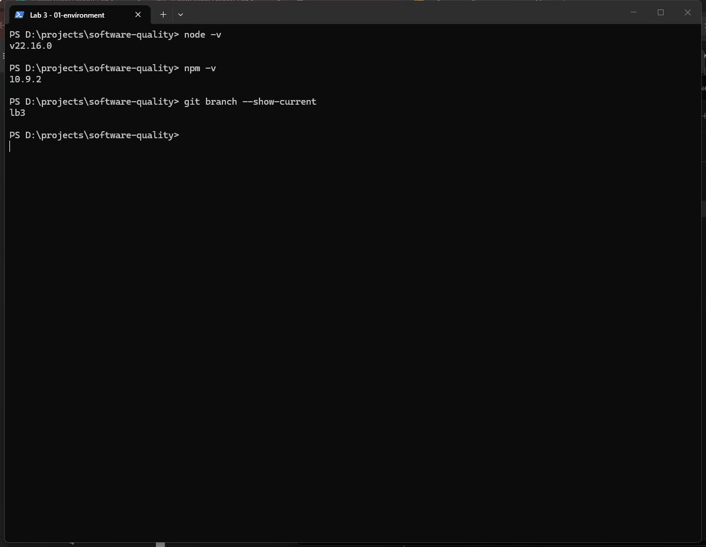


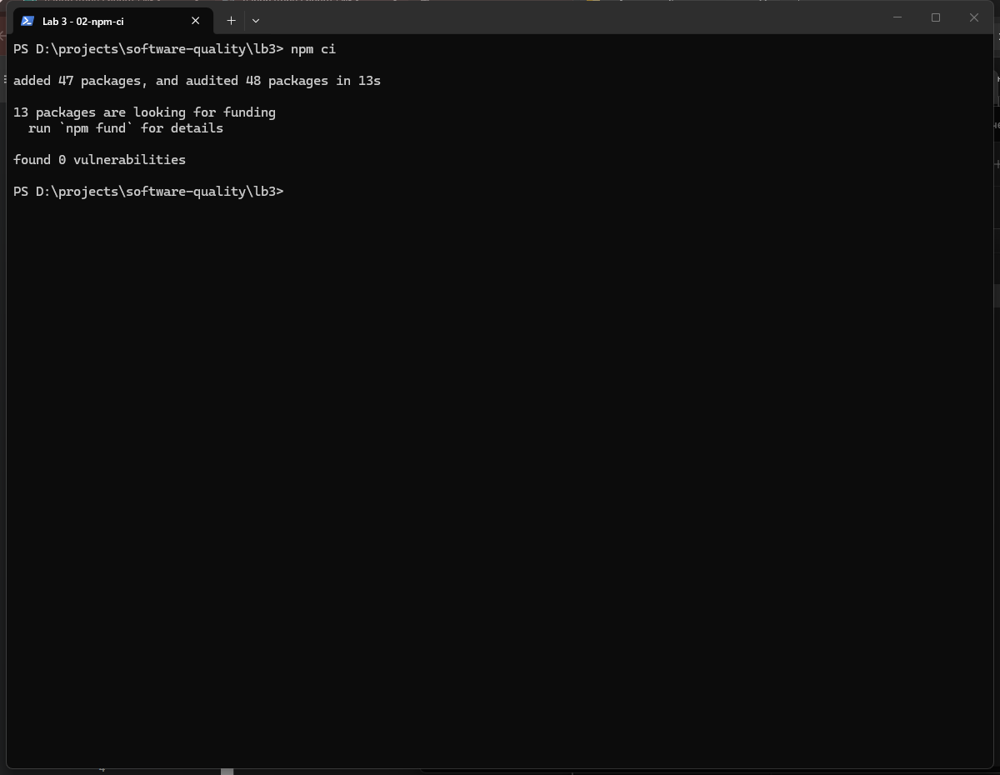


Після встановлення залежностей існує `node_modules/`, після вимірювання покриття -
`coverage/`. Обидві теки виключені з Git через `.gitignore`.

У `package.json` визначено scripts: `test: vitest` та
`coverage: vitest run --coverage`. У `vitest.config.js` налаштовано
`provider: 'v8'`, `include: ['src/**/*.js']`, `reporter: ['text', 'html']`.

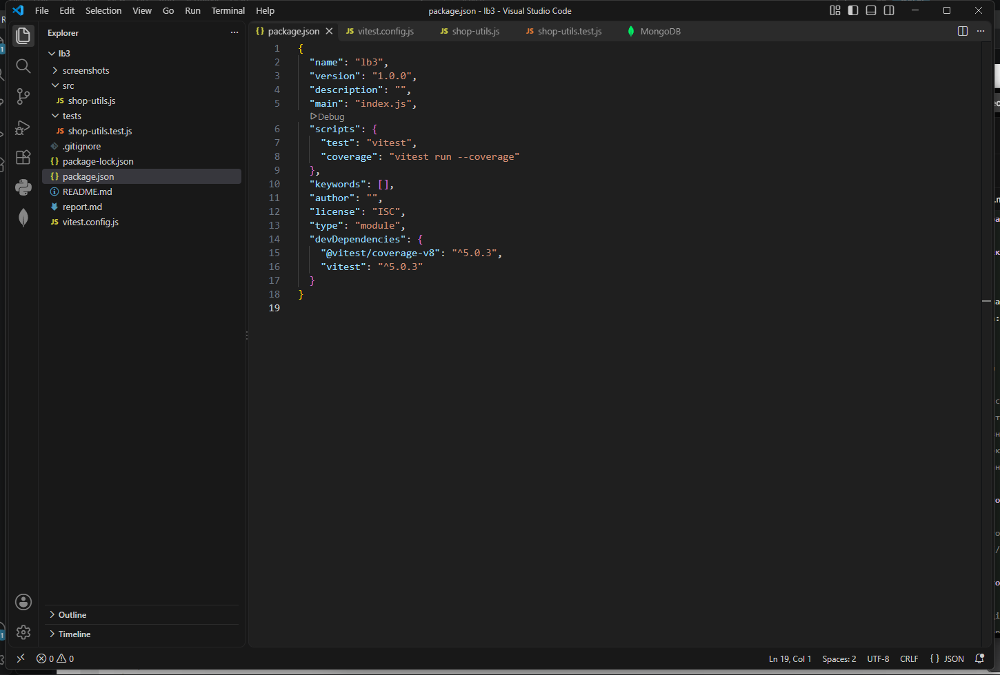

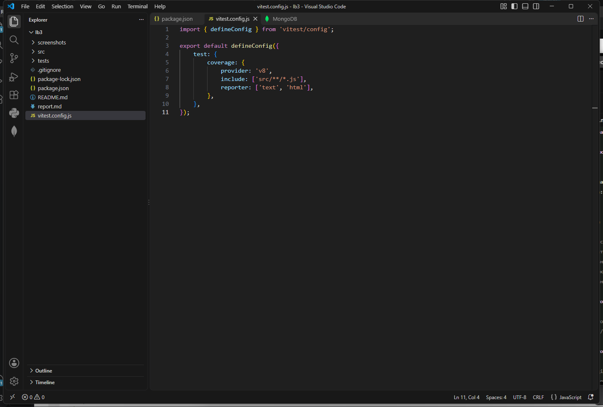

## 2. Test Object і Test Basis

**Test Object:** [`src/shop-utils.js`](src/shop-utils.js).
Тестуються три незалежні функції.

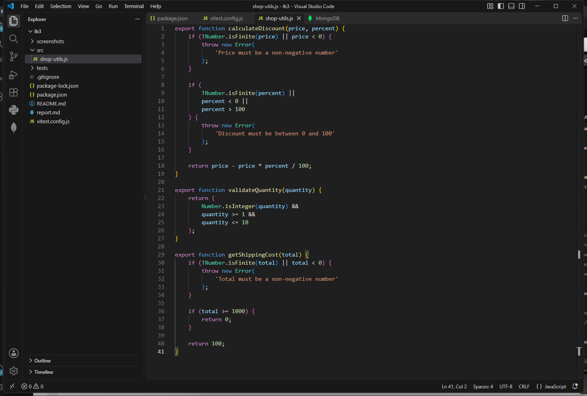

| Функція | Правила та очікувана поведінка |
|---|---|
| `calculateDiscount(price, percent)` | `price ≥ 0`; `0 ≤ percent ≤ 100`; результат `price - price × percent / 100`; некоректні аргументи спричиняють `Error`. |
| `validateQuantity(quantity)` | Лише ціле число від 1 до 10 включно повертає `true`, решта значень - `false`. |
| `getShippingCost(total)` | `total < 0` спричиняє `Error`; для `0 ≤ total < 1000` результат `100`; для `total ≥ 1000` - `0`. |

У реалізації для `price`, `percent` та `total` також використано
`Number.isFinite()`: `NaN` і нескінченні значення не допускаються.
Цю перевірку враховано під час розширення тестів.

## 3. Перший unit test та схема AAA

Перший тест створено в `describe('calculateDiscount', ...)`:

```javascript
test('returns 90 for price 100 and discount 10%', () => {
    // Arrange
    const price = 100;
    const percent = 10;

    // Act
    const result = calculateDiscount(price, percent);

    // Assert
    expect(result).toBe(90);
});
```

- **Arrange:** підготовлено `price = 100` та `percent = 10`.
- **Act:** викликано функцію й отримано Actual Result.
- **Assert:** Actual Result порівняно з очікуваним `90` через `toBe()`.

Expected Result визначено за Test Basis: `100 - 100 × 10 / 100 = 90`.
Перший окремий запуск дав **1 passed (1)**, тривалість - **356 ms**.

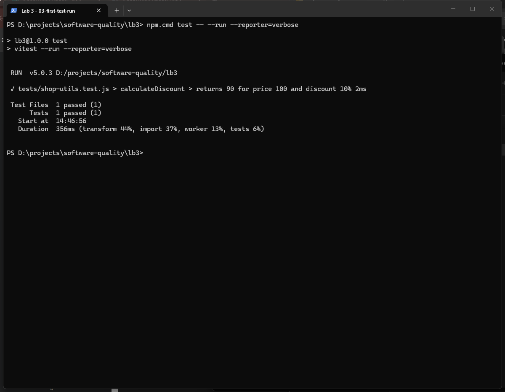

Для одноразового запуску використовувалася команда
`npm.cmd test -- --run --reporter=verbose`.

## 4. Test Design: calculateDiscount

Застосовано класи еквівалентності та перевірки меж допустимих аргументів.
Перші чотири рядки таблиці - обов'язкові сценарії, решта - розширення.

| Test Condition | price | percent | Expected Result |
|---|---:|---:|---|
| Звичайна знижка | 100 | 10 | `90` |
| Нижня допустима межа знижки | 100 | 0 | `100` |
| Верхня допустима межа знижки | 100 | 100 | `0` |
| Від'ємна ціна, сценарій 3 | -10 | 10 | `Error: Price must be a non-negative number` |
| Нижня допустима межа ціни | 0 | 10 | `0` |
| Ціна не є скінченним числом | `NaN` | 10 | `Error: Price must be a non-negative number` |
| Нескінченна ціна | `Infinity` | 10 | `Error: Price must be a non-negative number` |
| Знижка нижче нижньої межі | 100 | -1 | `Error: Discount must be between 0 and 100` |
| Знижка вище верхньої межі | 100 | 101 | `Error: Discount must be between 0 and 100` |
| Знижка не є скінченним числом | 100 | `NaN` | `Error: Discount must be between 0 and 100` |

### Розбір сценарію 3: від'ємна ціна

```javascript
// Arrange
const price = -10;
const percent = 10;

// Act + Assert
expect(() => calculateDiscount(price, percent)).toThrow(
    'Price must be a non-negative number'
);
```

`-10` належить до недопустимого класу цін. Функція має завершитися винятком,
тому числового результату не очікуємо. `toThrow()` викликає передану функцію,
перехоплює виняток та перевіряє повідомлення.

Обгортка `() => calculateDiscount(price, percent)` відкладає виклик до моменту
перевірки. Якщо написати `expect(calculateDiscount(price, percent))`, виняток
виникне ще до виклику `expect()`, і matcher не зможе його перевірити.
Тут **Act та Assert суміщені**, оскільки виклик виконується всередині matcher.
Негативний сценарій має статус **Pass**, коли очікуваний виняток справді виникає.

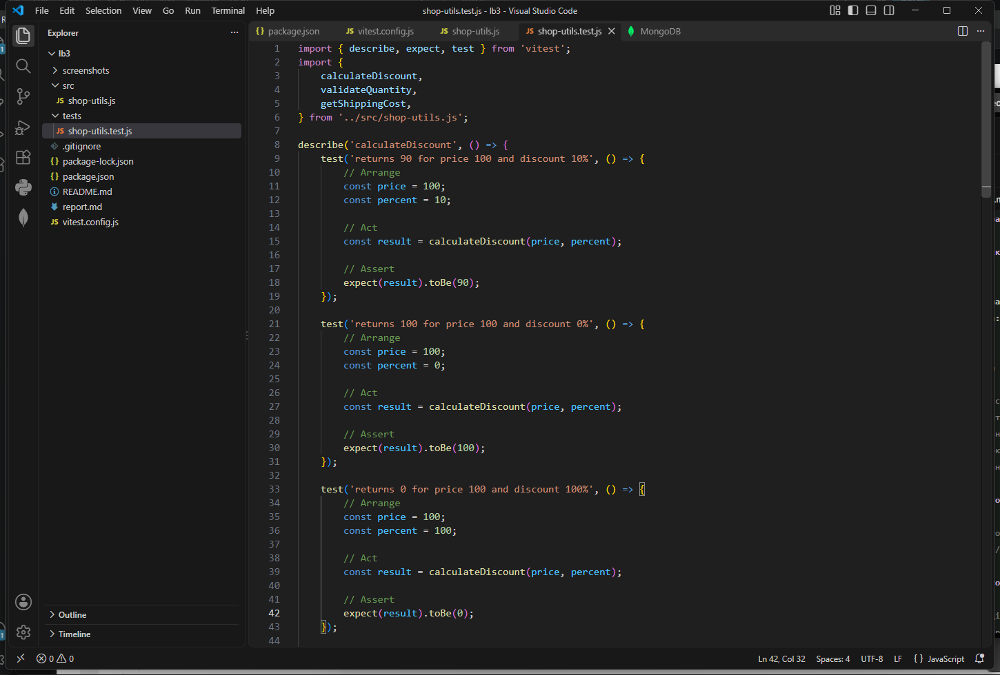

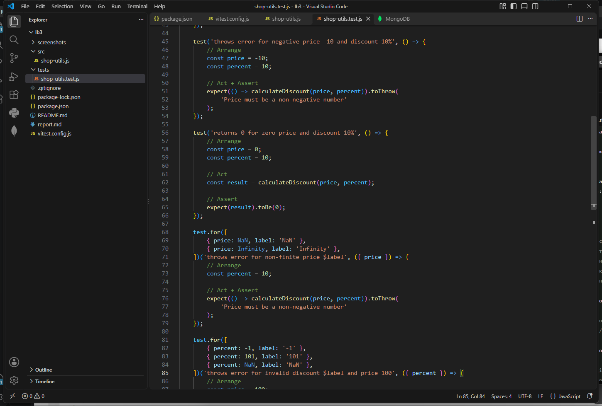

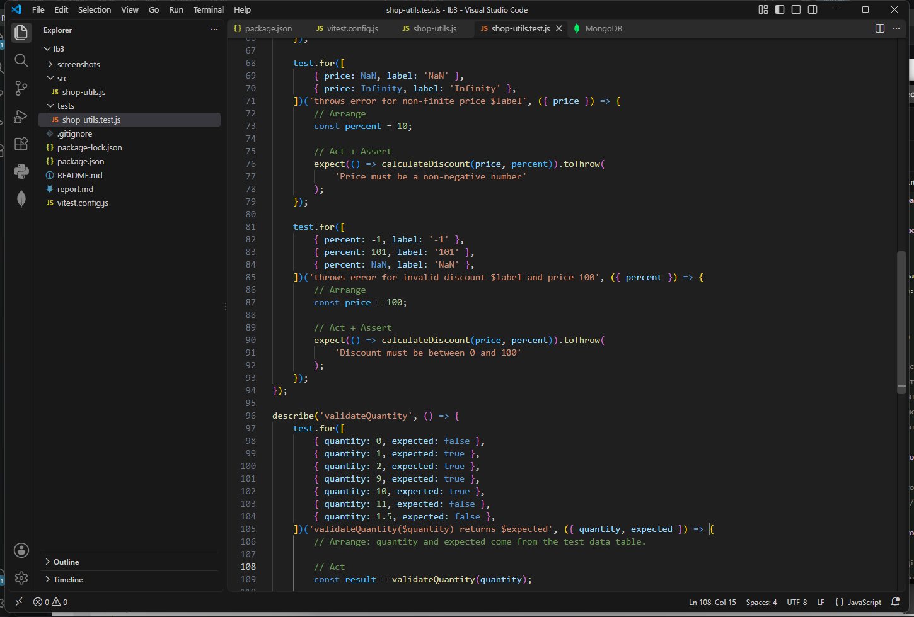

## 5. Test Design: validateQuantity

### Equivalence Partitions

| Клас значень | Partition | Expected |
|---|---|---|
| Ціле число менше 1 | Invalid | `false` |
| Ціле число від 1 до 10 включно | Valid | `true` |
| Ціле число більше 10 | Invalid | `false` |
| Неціле число | Invalid | `false` |

### Boundary Value Analysis

Для нижньої межі обрано **0, 1, 2**, для верхньої - **9, 10, 11**.
Значення **1.5** перевіряє вимогу цілочисельності всередині діапазону.

| quantity | Причина вибору | Expected |
|---:|---|---|
| 0 | Безпосередньо нижче нижньої межі | `false` |
| 1 | Нижня межа | `true` |
| 2 | Безпосередньо вище нижньої межі | `true` |
| 9 | Безпосередньо нижче верхньої межі | `true` |
| 10 | Верхня межа | `true` |
| 11 | Безпосередньо вище верхньої межі | `false` |
| 1.5 | Неціле число | `false` |

У групі `describe('validateQuantity', ...)` використано саме `test.for()`
з масивом об'єктів `{ quantity, expected }`.
Для кожного рядка Vitest створює окремий тест із назвою
`validateQuantity($quantity) returns $expected`. Підготовка даних відбувається
в таблиці, Act - виклик `validateQuantity(quantity)`, Assert -
`expect(result).toBe(expected)`.

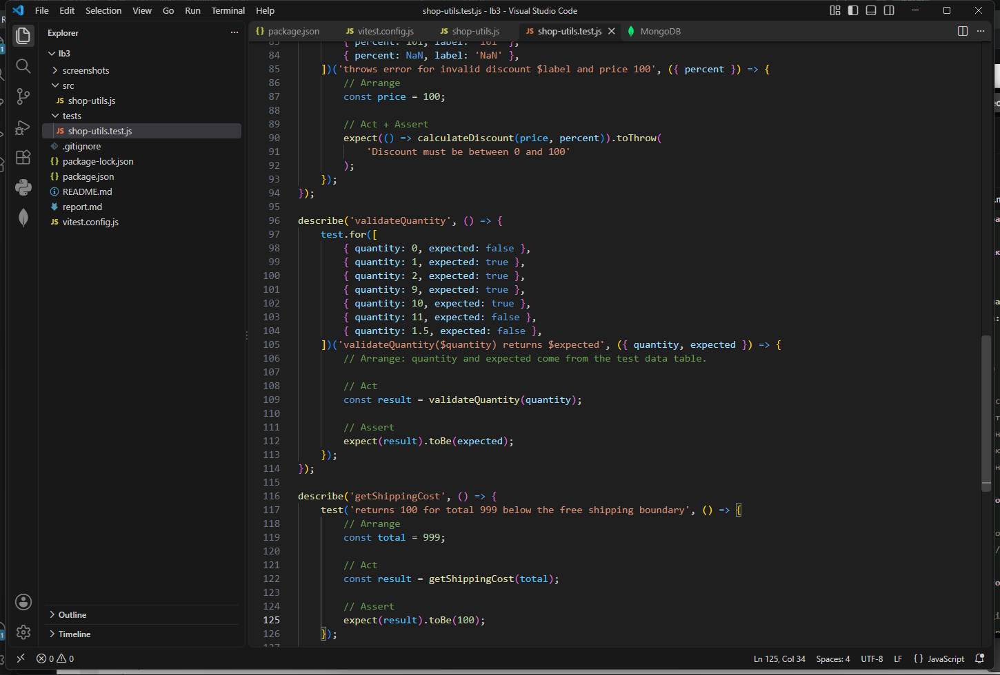

## 6. Test Design: getShippingCost

У групі `describe('getShippingCost', ...)` створено три окремі обов'язкові тести
та дві додаткові перевірки.

| total | Перевірена умова / гілка | Expected |
|---:|---|---|
| 999 | Перед межею безкоштовної доставки: `0 ≤ total < 1000` | `100` |
| 1000 | Сама межа: `total ≥ 1000` | `0` |
| -1 | Недопустиме від'ємне значення | `Error: Total must be a non-negative number` |
| 0 | Нижня допустима межа суми, додатково | `100` |
| `Infinity` | Нескінченна сума, додатково | `Error: Total must be a non-negative number` |

Перевірено повернення платної доставки, повернення безкоштовної доставки
та викидання винятку.

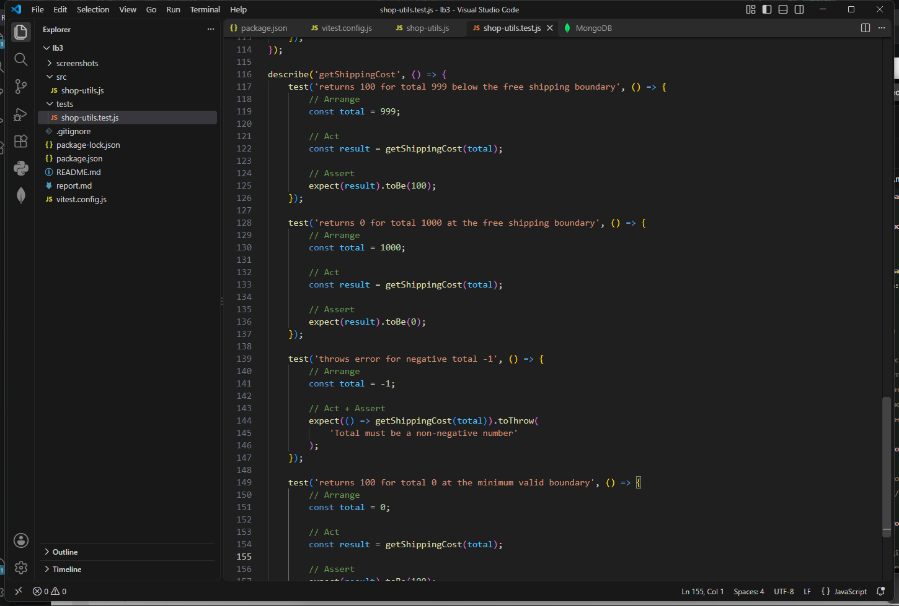

## 7. Результати тестування та аналіз Pass / Fail

Виконано три послідовні етапи:

| Етап | Кількість тестів | Pass | Fail |
|---|---:|---:|---:|
| Перший тест calculateDiscount | 1 | 1 | 0 |
| Усі обов'язкові сценарії | 14 | 14 | 0 |
| Після розширення та додаткового завдання | 22 | 22 | 0 |

Кількість обов'язкових тестів: **4 + 7 + 3 = 14**.

### Підсумковий запуск

```powershell
npm.cmd test -- --run --reporter=verbose
```

| Група тестів | Кількість | Pass | Fail | Result |
|---|---:|---:|---:|---|
| calculateDiscount | 10 | 10 | 0 | Pass |
| validateQuantity | 7 | 7 | 0 | Pass |
| getShippingCost | 5 | 5 | 0 | Pass |
| **Разом** | **22** | **22** | **0** | **Pass** |

Фактичний підсумок Vitest: **Test Files 1 passed (1), Tests 22 passed (22)**.

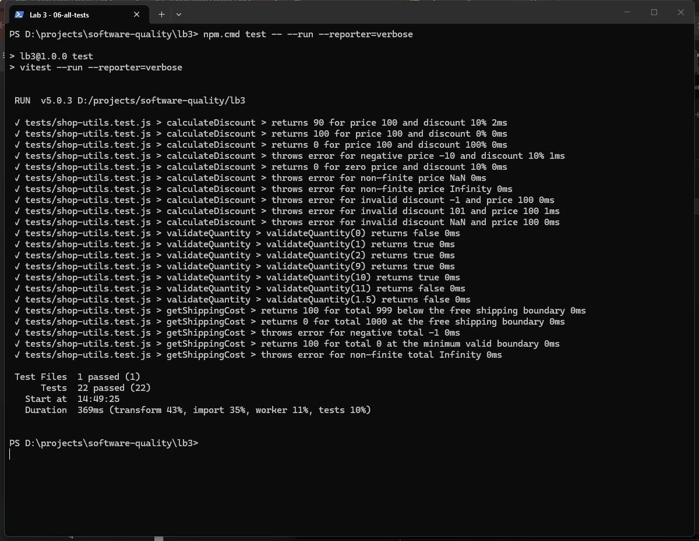


## 8. Coverage Report та додаткове завдання

### Початкове покриття після 14 обов'язкових тестів

Команда: `npm.cmd run coverage`. Фактичний результат:

| Metric | Result |
|---|---:|
| Statements | 90.9% |
| Branches | 94.44% |
| Functions | 100% |
| Lines | 90.9% |
| Uncovered Line #s | 13 |

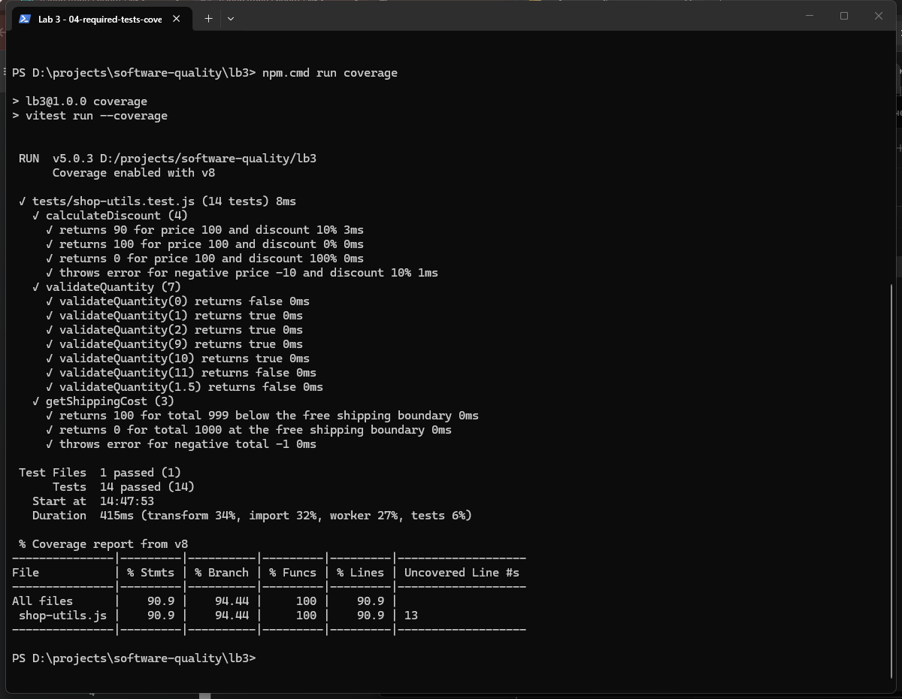

HTML-звіт `coverage/shop-utils.js.html` показав невиконаний рядок **13** -
`throw new Error(...)` для некоректного відсотка знижки.
Було покрито **10/11 statements**, **17/18 branches**, **3/3 functions**, **10/11 lines**.
Гілка помилки для `price` виконувалася, але в усіх тестах `percent` залишався допустимим.

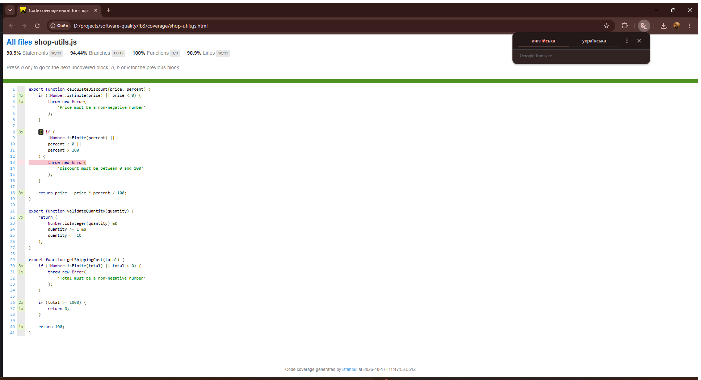

### Виконання додаткового завдання

Додано параметризовані перевірки `calculateDiscount(100, percent)`
для `percent = -1`, `101`, `NaN` з очікуванням
`Error: Discount must be between 0 and 100`.
Вони виконують раніше непокритий блок помилки та перевіряють обидва
недопустимі боки діапазону і відхилення `NaN` через `Number.isFinite()`.
Окремо додано `price = 0`, `NaN`, `Infinity` та `total = 0`, `Infinity`.
Усього розширення додало **8 тестів**.

### Підсумкове покриття після 22 тестів

Повторно виконано `npm.cmd run coverage`; отримано:

| Metric | Result | Дані HTML Coverage |
|---|---:|---:|
| Statements | **100%** | 11/11 |
| Branches | **100%** | 18/18 |
| Functions | **100%** | 3/3 |
| Lines | **100%** | 11/11 |

Для `All files` та `shop-utils.js` показники однакові, оскільки в `src/`
лише один файл. `Uncovered Line #s` порожній.
Під час запуску coverage також пройшли **22/22 тести**, тривалість - **409 ms**.

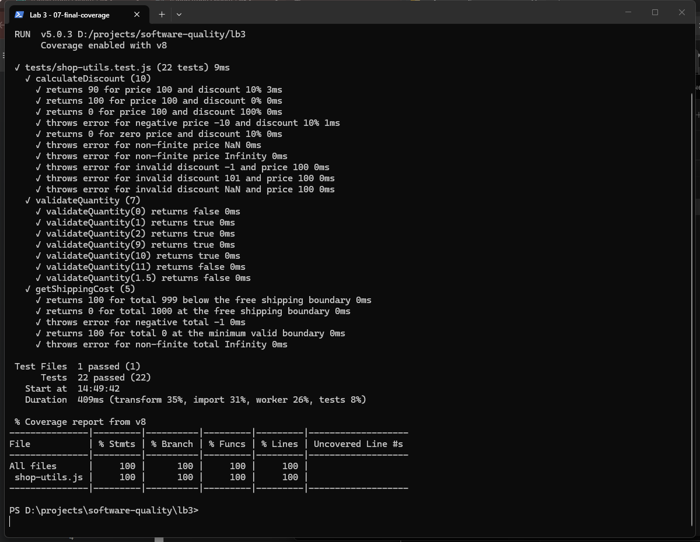

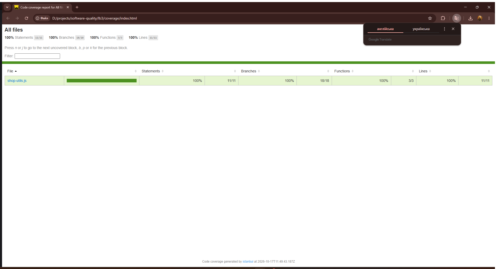

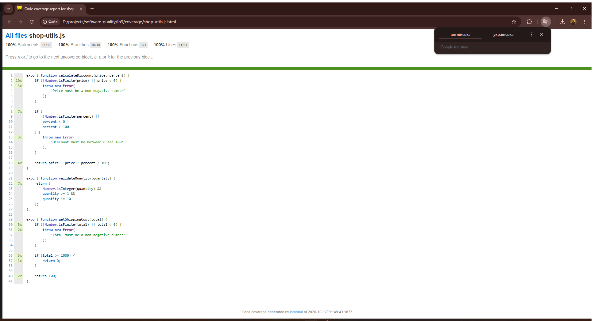

### Метрики

- **Statements:** частка виконаних інструкцій; тепер виконано також `throw` для неправильного `percent`.
- **Branches:** частка виконаних гілок, які враховує інструмент coverage;
  обидва результати умов та враховані шляхи виразів покриті цим набором.
- **Functions:** частка викликаних функцій; виконано всі три функції модуля.
- **Lines:** частка виконаних рядків з інструкціями; порожні рядки та форматування
  не є окремими виконуваними рядками, тому знаменник не дорівнює довжині файлу.


## 9. Git

Для виконання лабораторної роботи створено гілку **`lb3`**.


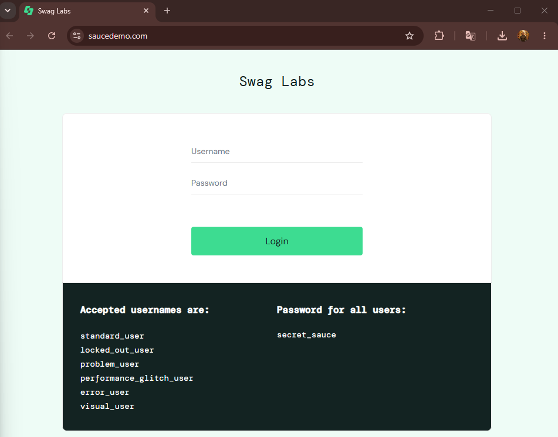


