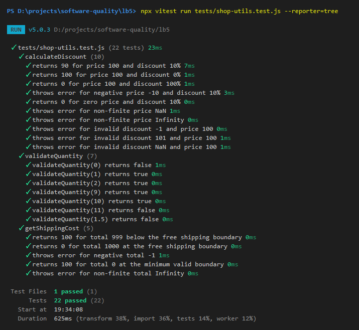
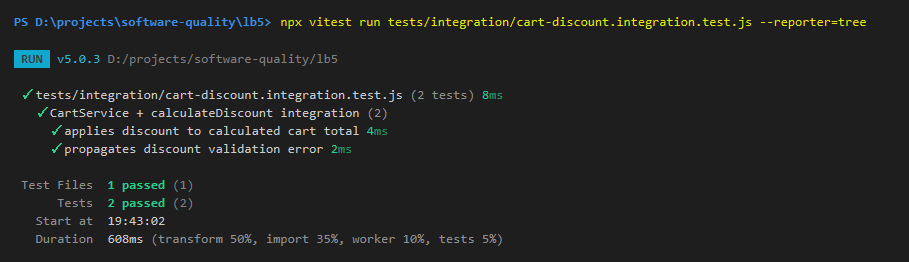
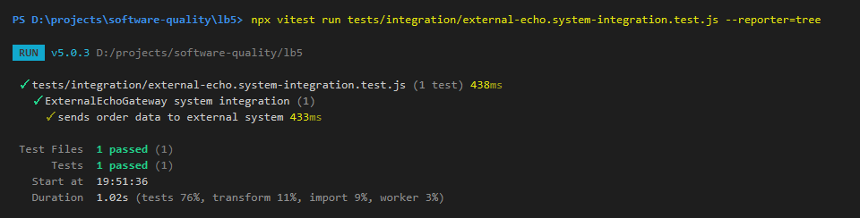
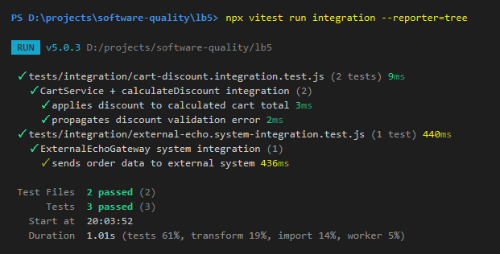
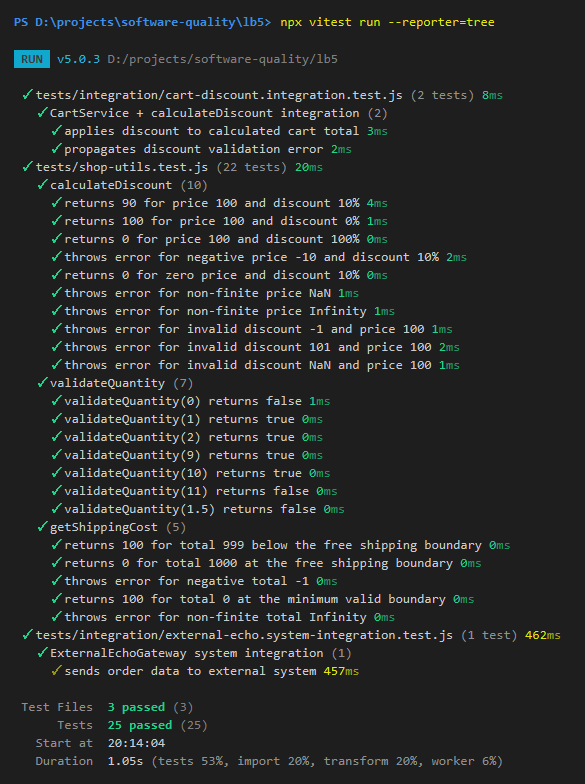
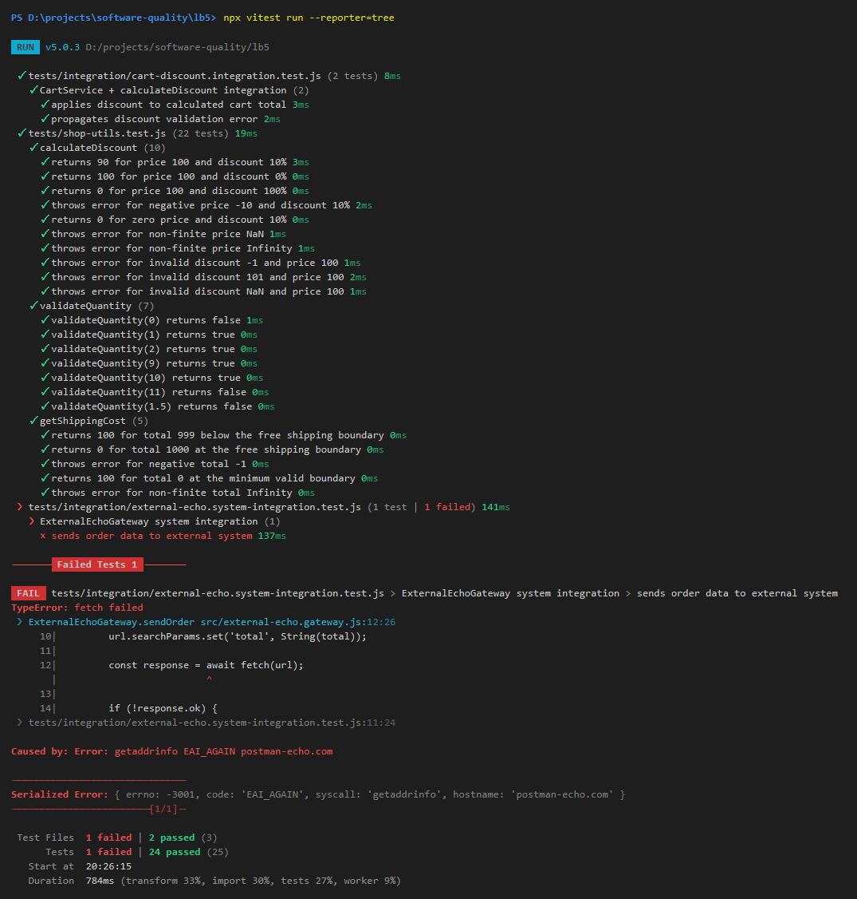

# Лабораторна робота №5

## Інтеграційне тестування компонентів та зовнішніх систем

**Виконав:** Пацера Ігор Євгенійович<br>
**Група:** 6.1213-пі-2

## Мета роботи

Навчитися відрізняти тестування окремого компонента від тестування взаємодії компонентів і від тестування взаємодії із зовнішньою системою. Створити інтеграційні тести для позитивного та негативного сценаріїв і перевірити, як наш код працює із зовнішнім HTTP-сервісом.

## 1. Підготовка

Створив гілку `lb5` і переніс у неї з ЛР №3 файл `src/shop-utils.js` (функція знижки `calculateDiscount()`) разом з його тестами. Встановив залежності командою `npm ci`.

Перед додаванням нових тестів запустив старі, щоб переконатися, що вони працюють.



## 2. Що тестуємо та очікувана поведінка

| Компонент | Як має працювати |
| :--- | :--- |
| Кошик `CartService` | Додає товари з ціною та кількістю. Сума кошика = сума (ціна × кількість). Метод `getFinalTotal(знижка)` рахує суму і застосовує до неї `calculateDiscount()` |
| Знижка `calculateDiscount()` | `100, 10% -> 90`; `100, 0% -> 100`; `100, 100% -> 0`. Якщо знижка поза межами 0-100, виникає помилка `Discount must be between 0 and 100` |
| Шлюз `ExternalEchoGateway` | Надсилає номер замовлення та суму на зовнішній сервіс Postman Echo. Сервіс повертає назад ті самі параметри у полі `args` |

Додав два нові файли:

- [`src/cart-service.js`](src/cart-service.js) - кошик, який використовує функцію знижки;
- [`src/external-echo.gateway.js`](src/external-echo.gateway.js) - шлюз, який робить HTTP-запит до Postman Echo.

## 3. Тест взаємодії компонентів

Перевіряється зв'язка двох наших компонентів: **кошик + функція знижки**.

### Сценарій 1 - Знижка на кошик

```javascript
// Підготовка: кошик з двома товарами
const cart = new CartService();
cart.addItem(100);
cart.addItem(200);

// Дія: отримуємо суму зі знижкою 10%
const result = cart.getFinalTotal(10);

// Перевірка
expect(result).toBe(270);
```

Очікуваний результат: `100 + 200 = 300`, знижка 10% -> `270`.

| Вхідні дані | Очікувано | Отримано | Результат |
| :--- | :--- | :--- | :--- |
| товари 100 і 200, знижка 10% | `270` | `270` | Пройдено |

### Сценарій 2 - Неправильна знижка (негативний тест)

Перевіряємо, що помилка з функції знижки передається через кошик до того, хто викликав метод.

```javascript
const cart = new CartService();
cart.addItem(100);

expect(() => cart.getFinalTotal(110)).toThrow(
    'Discount must be between 0 and 100'
);
```

| Вхідні дані | Очікувано | Отримано | Результат |
| :--- | :--- | :--- | :--- |
| товар 100, знижка 110% | помилка `Discount must be between 0 and 100` | ця сама помилка | Пройдено |



## 4. Тест взаємодії із зовнішньою системою

Перевіряється зв'язка **наш шлюз -> Інтернет -> сервіс Postman Echo**.

Шлюз надсилає запит `https://postman-echo.com/get?orderId=ORD-001&total=270` і повертає отримані від сервісу дані. Сума приходить як текст (`"270"`), тому шлюз перетворює її на число через `Number()`.

```javascript
const gateway = new ExternalEchoGateway();

const result = await gateway.sendOrder('ORD-001', 270);

expect(result).toEqual({ orderId: 'ORD-001', total: 270 });
```

| Вхідні дані | Очікувано | Отримано | Результат |
| :--- | :--- | :--- | :--- |
| номер `ORD-001`, сума `270` | `{ orderId: 'ORD-001', total: 270 }` | `{ orderId: 'ORD-001', total: 270 }` | Пройдено |



## 5. Запуск усіх тестів та аналіз

Окремо запустив усі інтеграційні тести командою `npx vitest run integration`: **3 пройдено**.



Потім запустив усі тести проєкту командою `npx vitest run`: **25 пройдено**. Нові тести не зламали старі з ЛР №3.



| Файл | Що перевіряє | Тестів | Пройдено | Не пройдено |
| :--- | :--- | ---: | ---: | ---: |
| `shop-utils.test.js` | окремі функції (ЛР №3) | 22 | 22 | 0 |
| `cart-discount.integration.test.js` | кошик + функція знижки | 2 | 2 | 0 |
| `external-echo.system-integration.test.js` | шлюз + Postman Echo | 1 | 1 | 0 |
| **Усього** | | **25** | **25** | **0** |

### Експеримент: робота без Інтернету

Перевірив, що буде, якщо Інтернет недоступний, і ще раз запустив усі тести командою `npx vitest run`.

Результат:

- тест із зовнішньою системою **не пройшов** (`fetch failed`, `getaddrinfo EAI_AGAIN postman-echo.com`);
- решта 24 тести **пройшли**, бо вони не використовують мережу.

Тобто падіння такого тесту не обов'язково означає помилку в коді: причиною може бути мережа або недоступність сервісу.



### Порівняння рівнів тестування

| Ознака | Окремий компонент | Взаємодія компонентів | Взаємодія із зовнішньою системою |
| :--- | :--- | :--- | :--- |
| Приклад | `calculateDiscount()` | кошик + `calculateDiscount()` | шлюз + Postman Echo |
| Межа | один компонент | компоненти нашої програми | наша програма + чужий сервіс |
| Потрібна мережа | ні | ні | так |
| Зовнішній сервіс | ні | ні | так |
| Швидкість | висока | висока | залежить від мережі |
| Причин для падіння | мало | більше | найбільше |

## Висновок

Створив два тести взаємодії кошика з функцією знижки (позитивний і негативний) та один тест взаємодії шлюзу із зовнішнім сервісом Postman Echo. Усі 25 тестів пройшли. Експеримент без Інтернету показав, що тест із зовнішньою системою залежить від мережі та стану чужого сервісу, а тести окремих компонентів і їх взаємодії від цього не залежать.
