# Лабораторна робота №6

## Автоматизація тестування вебінтерфейсу з використанням Playwright

**Виконав:** Пацера Ігор Євгенійович<br>
**Група:** 6.1213-пі-2<br>
**Дата:** 24.11.2026

## Мета роботи

Опанувати основні прийоми автоматизованого тестування вебінтерфейсу за допомогою Playwright, створити позитивні й негативні тестові сценарії, перевірити результати дій користувача у вебзастосунку та проаналізувати результати виконання тестів.

## Середовище тестування

| Параметр | Значення |
| :--- | :--- |
| ОС | Windows 11 |
| Мова | JavaScript (Node.js 22.16.0) |
| Інструмент | Playwright Test 1.65.1 |
| Браузер | Chromium |
| Об'єкт тестування | https://www.saucedemo.com/ |

## 1. Підготовка

Створив гілку `lb6` і переніс у неї вміст гілки `lb5`. Встановив залежності, додав Playwright Test і браузер Chromium:

```powershell
npm ci
npm i -D @playwright/test
npx playwright install chromium
```

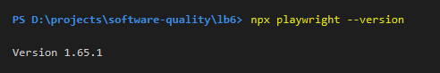

Створив [`playwright.config.js`](playwright.config.js):

| Параметр | Значення | Для чого |
| :--- | :--- | :--- |
| `testDir` | `./e2e` | папка з тестами Playwright |
| `baseURL` | `https://www.saucedemo.com` | `page.goto('/')` відкриває головну сторінку SauceDemo |
| `testIdAttribute` | `data-test` | `getByTestId()` шукає елементи за атрибутом `data-test`, як у SauceDemo |
| `screenshot` | `only-on-failure` | скріншот, якщо тест не пройшов |
| `trace` | `retain-on-failure` | трасування, якщо тест не пройшов |
| `projects` | `chromium` | браузер для запуску |

У [`vitest.config.js`](vitest.config.js) виключив папку `e2e`, щоб Vitest не запускав тести Playwright:

```javascript
import { defineConfig, configDefaults } from 'vitest/config';

export default defineConfig({
    test: {
        exclude: [...configDefaults.exclude, 'e2e/**']
    }
});
```

У `.gitignore` додав `playwright-report/` і `test-results/`.

Тести з попередніх лабораторних після налаштування: **25 пройдено**.

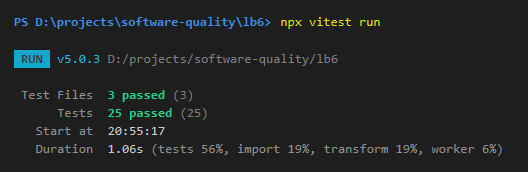

## 2. Тестові сценарії

| ID | Сценарій | Тестові дані | Очікуваний результат |
| :--- | :--- | :--- | :--- |
| TC-01 | Успішна авторизація | `standard_user` / `secret_sauce` | відкривається каталог товарів |
| TC-02 | Авторизація з неправильним паролем | `standard_user` / `wrong_password` | з'являється повідомлення про помилку |
| TC-03 | Додавання товару до кошика | `standard_user` / `secret_sauce`, товар `Sauce Labs Bolt T-Shirt` | вибраний товар відображається в кошику |
## 3. TC-01. Успішна авторизація

Відкриваємо сторінку входу, вводимо правильні логін і пароль, натискаємо Login. Перевіряємо, що адреса змінилася на `inventory.html` і з'явився заголовок `Products`.

```javascript
test('TC-01: Успішна авторизація', async ({ page }) => {
    await page.goto('/');
    await page.getByTestId('username').fill('standard_user');
    await page.getByTestId('password').fill('secret_sauce');
    await page.getByTestId('login-button').click();

    await expect(page).toHaveURL(/inventory\.html/);
    await expect(page.getByText('Products', { exact: true })).toBeVisible();
});
```

Запустив з відкриттям вікна браузера командою `npx playwright test --headed`:

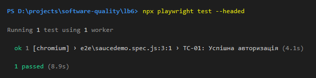

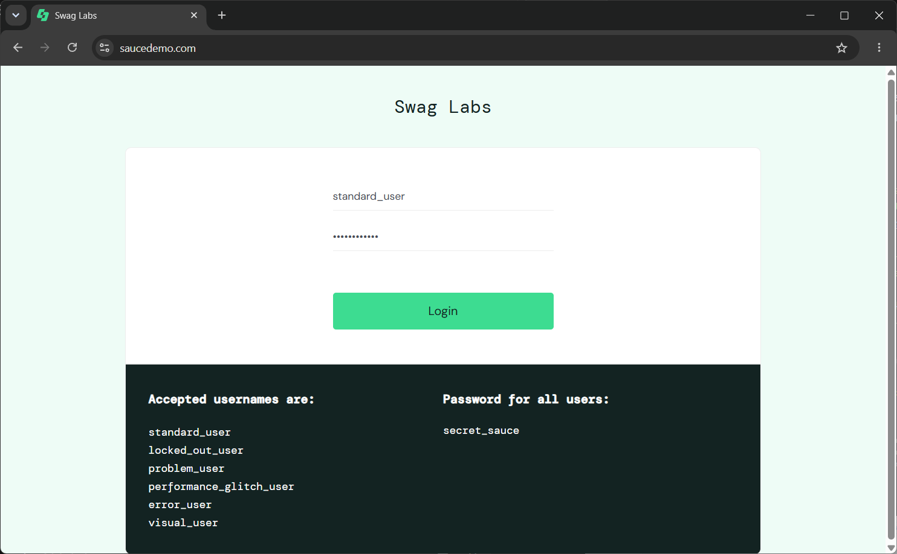

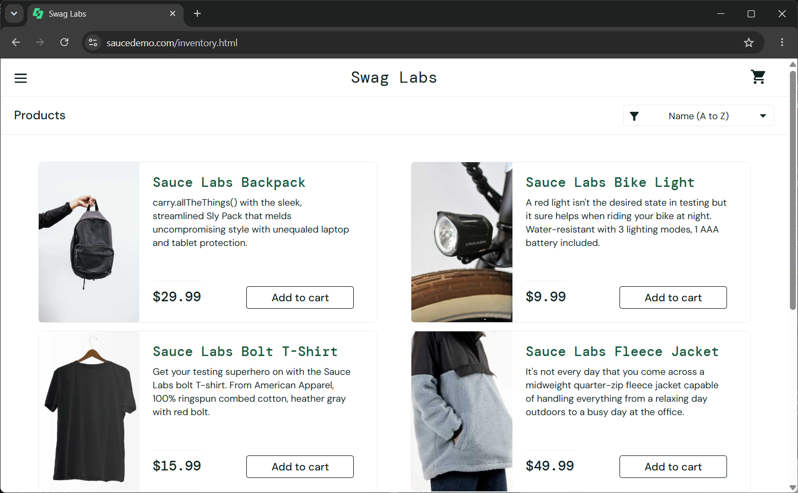

У HTML-звіті (`playwright-report/index.html`) усі кроки тесту виконані успішно:

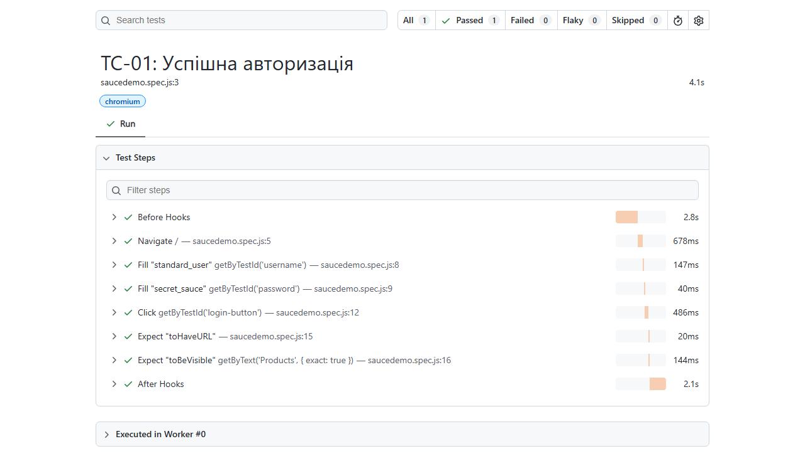

## 4. TC-02. Авторизація з неправильним паролем

Те саме, що TC-01, але з паролем `wrong_password`. Перевіряємо повідомлення про помилку.

```javascript
test('TC-02: Авторизація з неправильним паролем', async ({ page }) => {
    await page.goto('/');
    await page.getByTestId('username').fill('standard_user');
    await page.getByTestId('password').fill('wrong_password');
    await page.getByTestId('login-button').click();

    const errorMessage = page.getByTestId('error');
    await expect(errorMessage).toBeVisible();
    await expect(errorMessage).toContainText('Username and password do not match');
});
```

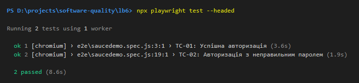

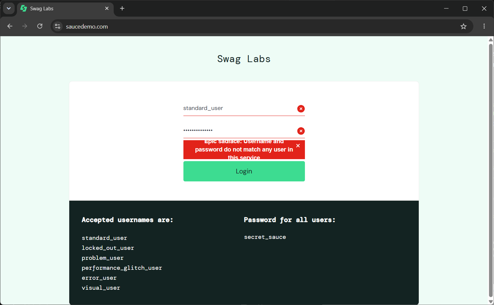

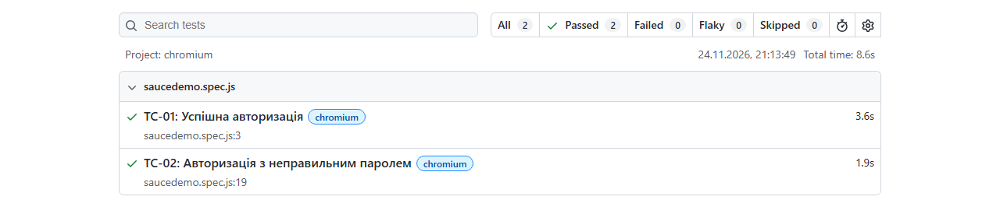

## 5. TC-03. Додавання товару до кошика

Авторизуємося, додаємо `Sauce Labs Bolt T-Shirt`, перевіряємо, що на значку кошика `1`, відкриваємо кошик і перевіряємо назву товару.

```javascript
test('TC-03: Додавання товару до кошика', async ({ page }) => {
    await page.goto('/');
    await page.getByTestId('username').fill('standard_user');
    await page.getByTestId('password').fill('secret_sauce');
    await page.getByTestId('login-button').click();

    await page.getByTestId('add-to-cart-sauce-labs-bolt-t-shirt').click();
    await expect(page.locator('.shopping_cart_badge')).toHaveText('1');

    await page.locator('.shopping_cart_link').click();
    await expect(page.getByText('Sauce Labs Bolt T-Shirt', { exact: true })).toBeVisible();
});
```

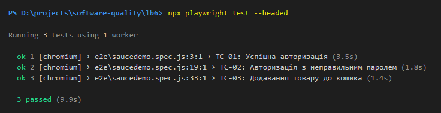

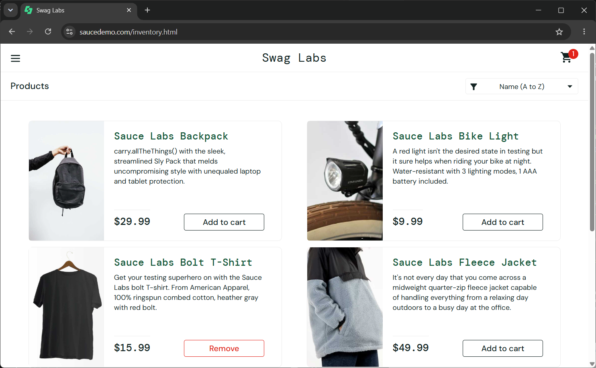

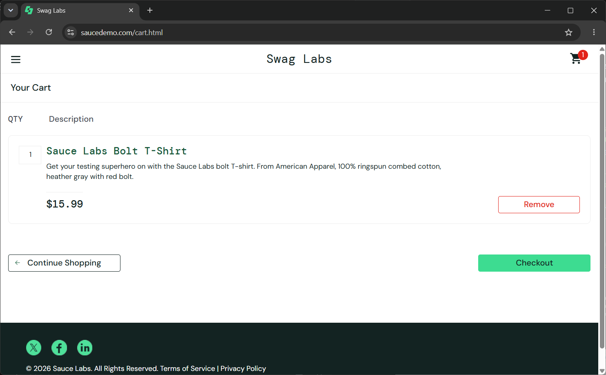

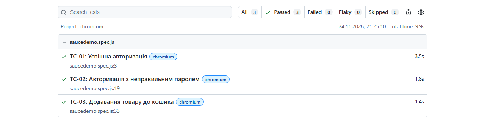

### Експеримент: помилка в назві товару

У TC-03 навмисно змінив назву товару на `Sauce Labs Bolt T-Shirtt` і запустив тести.

Результат: TC-01 і TC-02 **пройшли**, TC-03 **не пройшов** (`element(s) not found`).

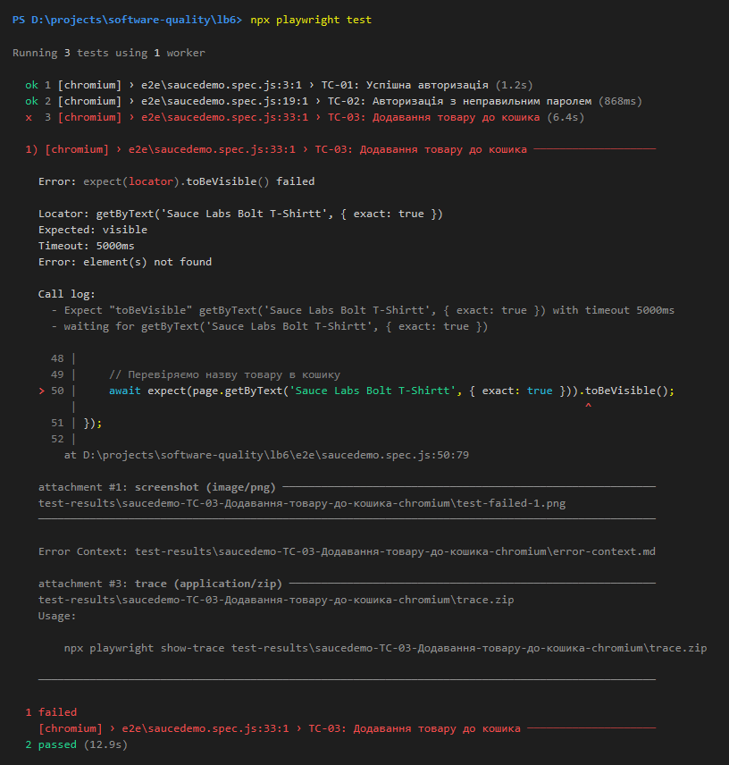

На скріншоті в кошику `Sauce Labs Bolt T-Shirt`, отже помилка в тесті, а не в застосунку.

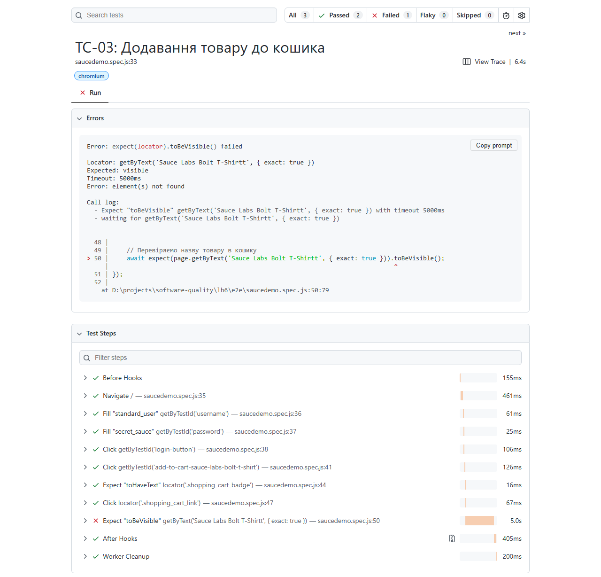

У Trace впала лише остання перевірка:

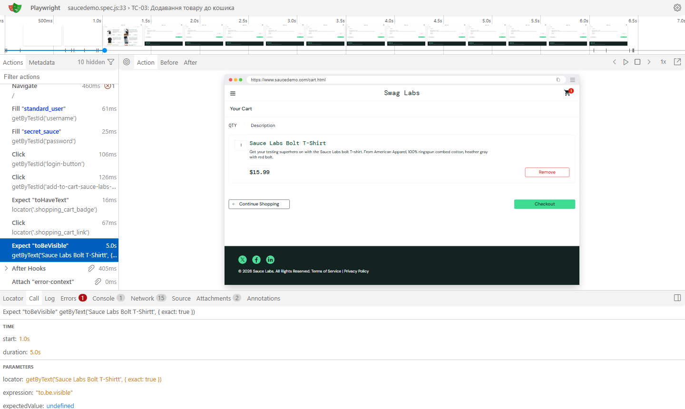

Після експерименту повернув правильну назву товару.

## 6. Запуск усіх тестів та аналіз

Запустив усі тести без вікна браузера командою `npx playwright test`: **3 пройдено**.

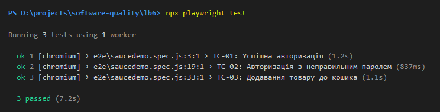

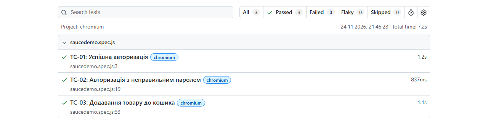

| ID | Тест | Очікуваний результат | Фактичний результат | Тривалість | Статус |
| :--- | :--- | :--- | :--- | ---: | :--- |
| TC-01 | Успішна авторизація | відкривається каталог товарів | відкрилася сторінка `inventory.html` із заголовком `Products` | 1.2 с | Passed |
| TC-02 | Неправильний пароль | повідомлення про помилку | з'явилося повідомлення `Epic sadface: Username and password do not match any user in this service` | 837 мс | Passed |
| TC-03 | Додавання товару | товар є в кошику | на значку кошика `1`, у кошику відображається `Sauce Labs Bolt T-Shirt` | 1.1 с | Passed |

Загальний час запуску - 7.2 с.

Аналіз:

- Усі три сценарії працюють так, як очікувалося. Дефектів у SauceDemo не знайдено.
- Експеримент показав, що тест може впасти через помилку в самому тесті, а не в застосунку.

## Висновок

Налаштував Playwright для тестування SauceDemo і створив три автоматизовані тести: успішна авторизація, авторизація з неправильним паролем і додавання товару до кошика. Усі тести пройшли. Експеримент з помилкою в назві товару показав, як за звітом і Trace знайти причину невдалого тесту.
