# Лабораторна робота №4

## Тестування HTTP API за допомогою Postman

**Виконав:** Пацера Ігор Євгенійович<br>
**Група:** 6.1213-пі-2

## Мета роботи

Навчитися створювати запити в Postman, використовувати змінні колекції та писати автоматизовані перевірки відповідей API.

## 1. Test Object та Test Basis

Для роботи використав Postman Echo з адресою `https://postman-echo.com`.
Очікувані результати взяв з умови лабораторної. У параметрі `name` вказав своє ім'я `Ihor`.

| Запит | Дані | Очікуваний результат |
| :--- | :--- | :--- |
| GET `/get` | `name=Ihor`, `role=student` | HTTP 200; Content-Type містить `application/json`; `args.name = "Ihor"`; `args.role = "student"` |
| POST `/post` | `{"product":"Backpack","quantity":2}` | HTTP 200; у `data` є `product = "Backpack"` і `quantity = 2` з типом `number` |
| GET `/status/404` | Без тіла | HTTP 404; у тілі `status = 404` |

## 2. Колекція

Створив колекцію **Lab 4 - API Testing** і додав до неї три запити:

1. `01 GET with Params`.
2. `02 POST JSON`.
3. `03 Negative - 404`.

У Variables додав `baseUrl = https://postman-echo.com`. В адресах запитів використав `{{baseUrl}}`.

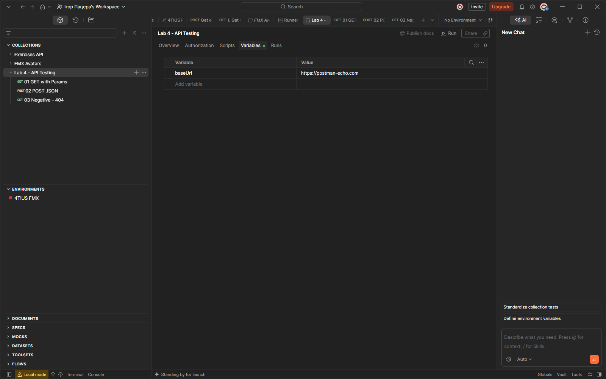

## 3. GET із параметрами

Надіслав `GET {{baseUrl}}/get?name=Ihor&role=student`.
Отримав `200 OK`, час відповіді 425 мс. У тілі перевірив `args.name` і `args.role`, а в заголовках - `Content-Type: application/json; charset=utf-8`.

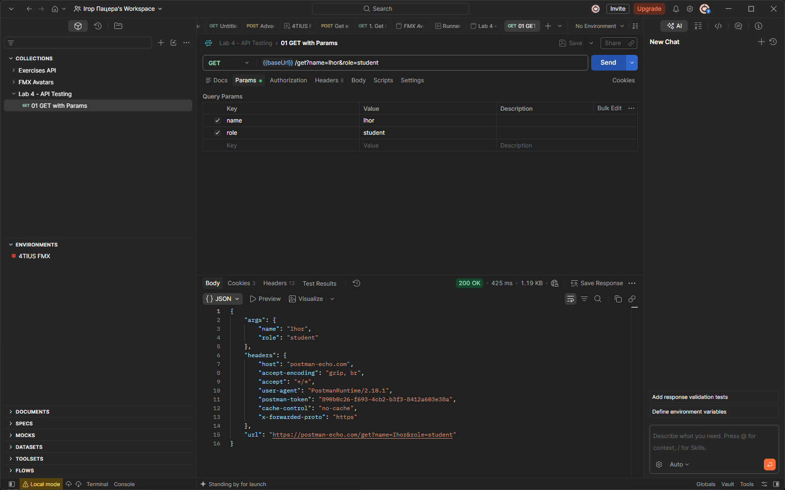

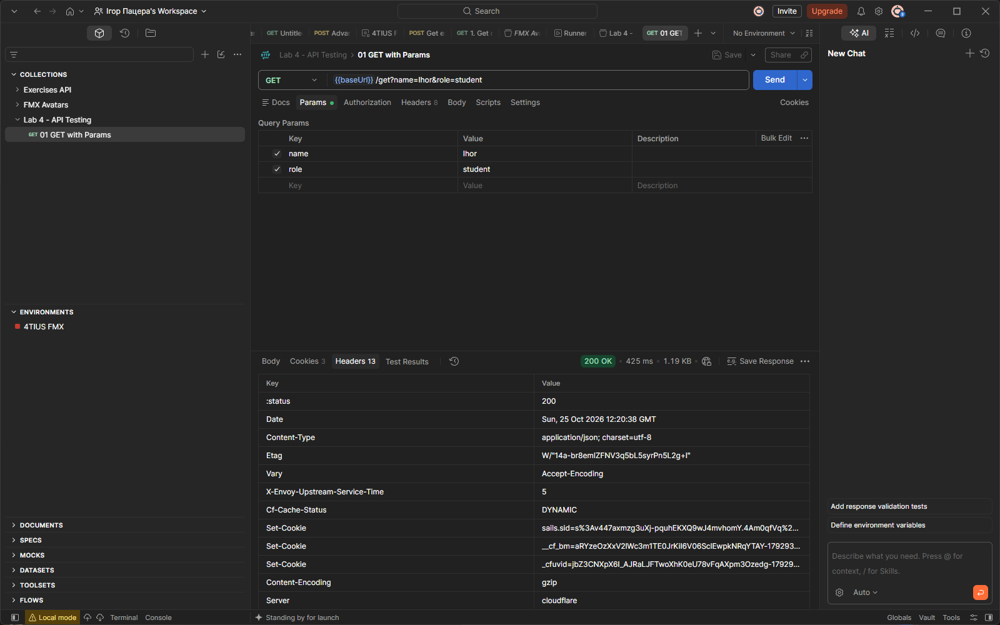

У Scripts -> After response додав чотири тести: статус 200, Content-Type містить `application/json`, ім'я дорівнює `Ihor`, роль дорівнює `student`.
Для читання тіла використав `pm.response.json()`, для перевірок - `pm.response.to.have.status()` і `pm.expect()`.

Для експерименту змінив очікувану роль на `teacher` і натиснув Send. Отримав **3 PASSED і 1 FAILED** з помилкою `expected 'student' to deeply equal 'teacher'`.

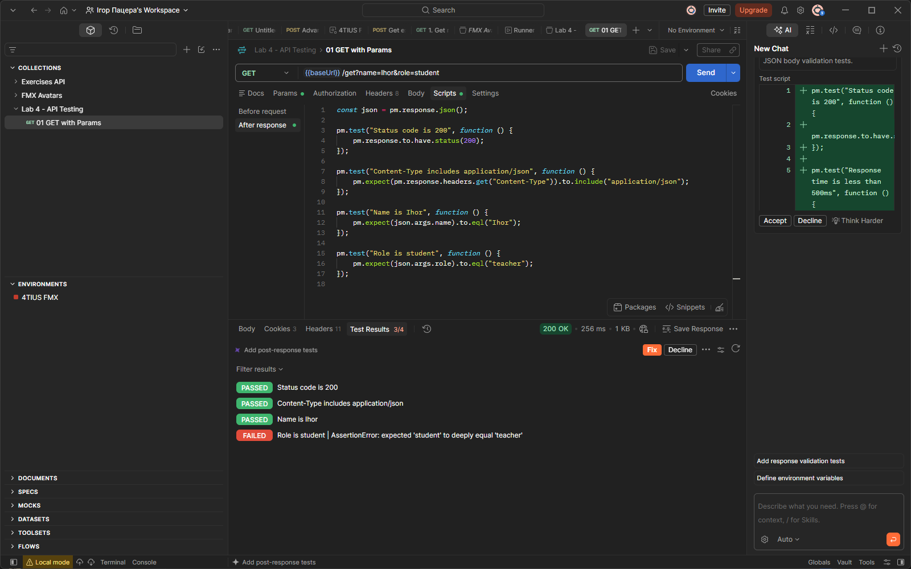

Повернув очікування `student` і повторив запит. Усі **4 тести пройшли**.

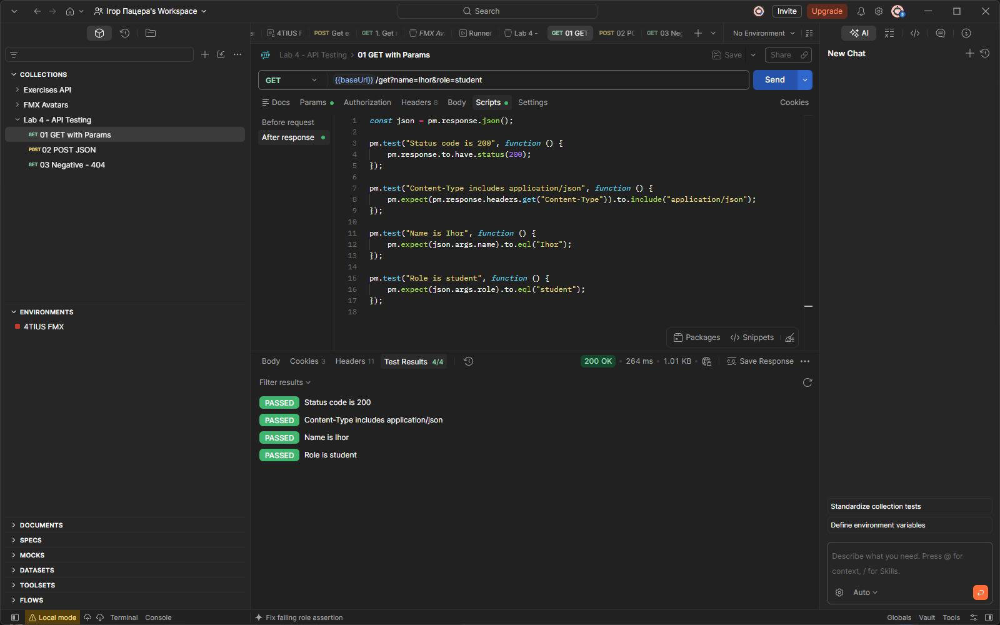

## 4. POST із JSON

Створив `POST {{baseUrl}}/post`. У Body -> raw -> JSON додав:

```json
{
  "product": "Backpack",
  "quantity": 2
}
```

Отримав HTTP 200 за 236 мс. У відповіді перевірив об'єкт `data` з відправленими значеннями.

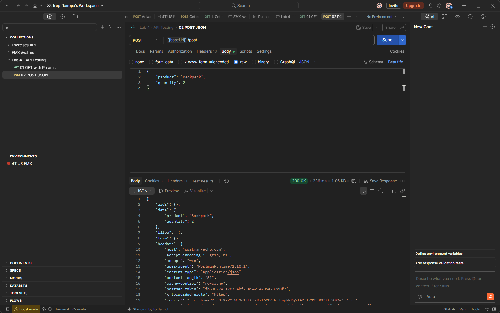

Додав п'ять тестів:

1. HTTP-статус дорівнює 200.
2. У `data` є властивість `product`.
3. `data.product` дорівнює `"Backpack"`.
4. `data.quantity` дорівнює `2`.
5. Тип `data.quantity` - `number`.

Запустив запит повторно й отримав **5 PASSED**.

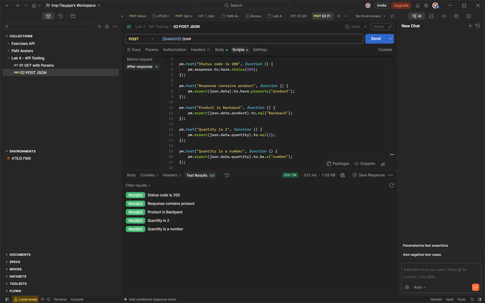

## 5. Негативний тест

Надіслав `GET {{baseUrl}}/status/404`. Отримав `404 Not Found` і тіло `{"status":404}` за 366 мс.

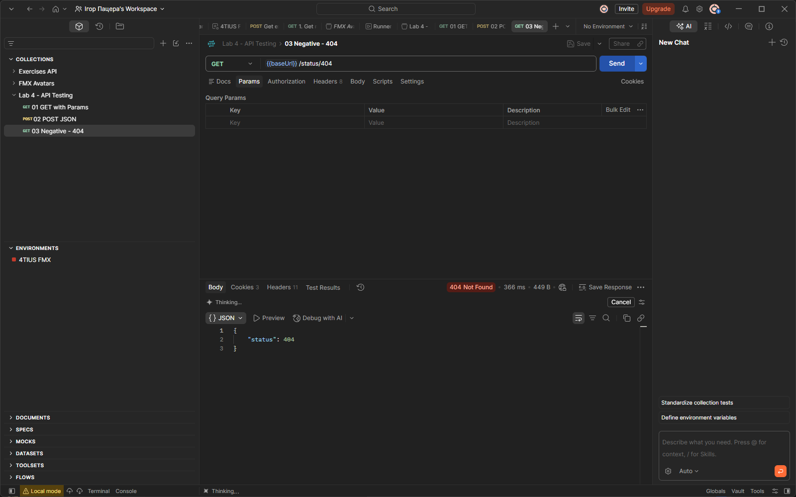

Додав два тести: перевірив HTTP-статус через `pm.response.to.have.status(404)` і значення в тілі через `pm.expect(json.status).to.eql(404)`.
Обидва тести пройшли, бо за умовою очікував саме 404.

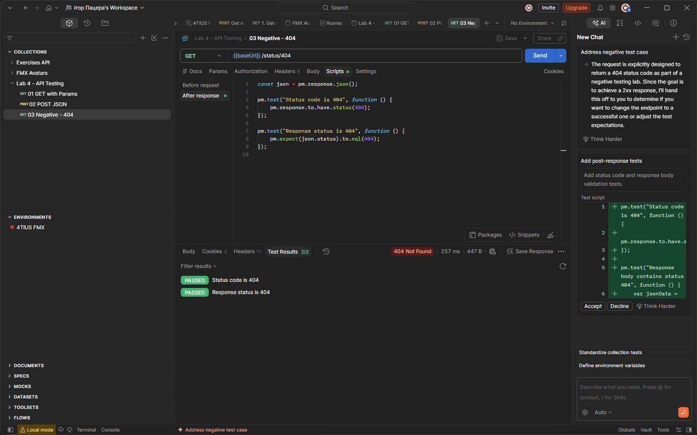

## 6. Результати

У Collection Runner вибрав три запити, одну ітерацію та `No Environment`.
Після запуску отримав **11 PASSED, 0 FAILED, 0 помилок**.

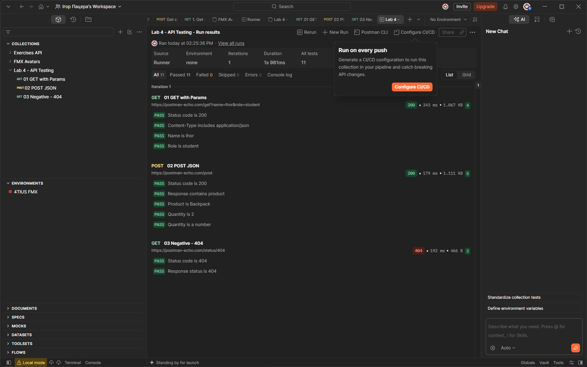

Підготував [JSON колекції](Lab4.postman_collection.json), імпортував його як `Lab 4 - API Testing Copy` і ще раз запустив тести.

| Запит | HTTP-статус | Час відповіді | Тестів | Passed | Failed |
| :--- | :--- | :--- | ---: | ---: | ---: |
| GET with Params | 200 | 297 мс | 4 | 4 | 0 |
| POST JSON | 200 | 203 мс | 5 | 5 | 0 |
| Negative - 404 | 404 | 183 мс | 2 | 2 | 0 |
| **Усього** | | | **11** | **11** | **0** |

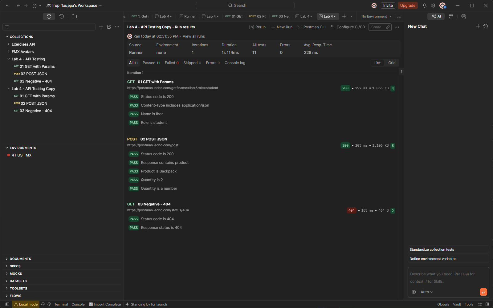

## Висновок

Створив колекцію з трьома запитами та 11 перевірками. Перевірив параметри GET, JSON-тіло POST і відповідь зі статусом 404. Після виправлення очікування `teacher` на `student` усі тести пройшли. Повторний запуск після імпорту JSON теж дав 11 PASSED.
